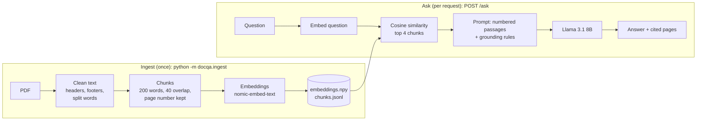

# DocQA: Document Q&A with RAG and an Eval Report

Ask questions about a PDF and get short answers that **cite the pages they come from**, served through a REST API. Everything runs locally and free: a local LLM through [Ollama](https://ollama.com), local embeddings, and plain NumPy vector search.

The source document is the [NIST AI Risk Management Framework (AI RMF 1.0)](https://nvlpubs.nist.gov/nistpubs/ai/NIST.AI.100-1.pdf), a public-domain US government publication (48 pages).

The interesting part is the **evaluation**: 30 hand-written questions, 4 configurations compared, and every failure traced to a cause.

```text
$ curl -s -X POST localhost:8000/ask -H 'Content-Type: application/json' \
    -d '{"question": "What should happen to an AI system that presents unacceptable risk?"}'

{"answer": "Development and deployment should cease in a safe manner until risks can be sufficiently managed. [1]",
 "refused": false,
 "sources": [{"n": 1, "page": "p. 8", "score": 0.836, "text": "When applying the AI RMF, risks which ..."}], ...}
```

## How it works



1. **Ingest** (`docqa/ingest.py`): extract text per page, strip the repeated header and the `Page N` footer, rejoin words split across lines (`envi-\nronment` becomes "environment", but `high-\nor low` keeps its real hyphen), and skip front matter (notice, table of contents). Chunk each page into 200-word windows with 40 words of overlap. Embed with `nomic-embed-text`, normalise, and save.
2. **Retrieve** (`docqa/retrieve.py`): embed the question and score every chunk with one matrix-vector product (normalised vectors, so the dot product equals cosine similarity). For ~100 chunks this is instant; a vector database only pays off at much larger sizes.
3. **Answer** (`docqa/answer.py`, `docqa/prompts.py`): put the top 4 passages in the prompt as `[1] (p. 12) ...`. The default prompt (`v2_grounded`) says to use only those passages, cite them by number, and reply with an exact refusal sentence if the answer isn't there. Only the passages the model actually cited are returned as sources.
4. **Serve** (`docqa/api.py`): FastAPI with Pydantic validation. Bad input returns 422; if Ollama is down, the API returns 503 with a clear message instead of crashing.

## Evaluation

`evals/questions.jsonl` has **30 questions**: 25 answerable (each with the page holding the answer and the keywords a correct answer must contain) and **5 unanswerable traps** that sound plausible but aren't covered by the document ("What new functions were added in AI RMF 2.0?"). Scoring is deterministic, with no LLM judge, so every result can be checked by hand. Per-question outputs are in `evals/results/`.

| Config | Retrieval hit@4 | Correct answers | Correct refusals | False refusals | Answers with citation | Sec/question |
| --- | --- | --- | --- | --- | --- | --- |
| chunk 200/40, v1_basic | 96% | 24/25 | 0/5 | 0 | 3/25 | 6.7 |
| **chunk 200/40, v2_grounded (default)** | 96% | 24/25 | **5/5** | 1 | 24/25 | **5.5** |
| chunk 200/40, v3_quote_first | 96% | 23/25 | 3/5 | 1 | 23/25 | 7.1 |
| chunk 400/80, v2_grounded | 96% | 24/25 | 5/5 | 0 | 25/25 | 7.4 |

Measured on an Apple M2 Pro (16 GB), Llama 3.1 8B, temperature 0.

### Findings

- **Grounding rules mostly change the format, not the facts.** The basic prompt (v1) got as many facts right, and it also declined the trap questions, but in free-form wording ("The provided text does not mention…"), with citations on only 3 of 25 answers. v2's exact refusal sentence and numbered citations are what make the output **checkable by code**. That's what an app or an eval pipeline needs.
- **"Think first" prompting didn't help this model.** v3 asks the model to quote evidence before answering. It was slower (7.1 vs 5.5 s per question), once said "these four NIST frameworks" without naming them, and twice added explanations after the refusal sentence, breaking the exact format (it did decline all 5 traps in spirit).
- **Bigger chunks traded a safe refusal for a confident wrong answer.** With 400-word chunks, the one retrieval miss (below) produced "The AI RMF does not explicitly define risk", which is false. With 200-word chunks the model said "I don't know". A confident wrong answer is worse, so 200/40 is the default.
- **The one retrieval miss is a vocabulary mismatch.** "How does the AI RMF define risk?" fails in every configuration. The document says risk "*refers to* the composite measure of an event's probability…". The question says "*define*", and the chunk ranks 8th. Asking with the document's wording ("What does risk refer to…") lifts it to 4th. Hybrid search (BM25 keywords plus vectors) or query rewriting are the standard fixes; see next steps.
- **Front-matter pages were noise.** The table of contents and list of figures repeat section titles, so they matched many questions without containing answers, and an early answer even cited the list of figures. Ingest now skips pages without a printed page number. This removed the noise, but on its own didn't fix the vocabulary miss above.

### Limitations of the eval
- Keyword scoring can miss a correct paraphrase or accept a lucky wrong one, so failures were reviewed by hand.
- 30 questions on one document is small; differences of one or two questions are not statistically meaningful.

## Setup

Needs Python 3.11+ and the [Ollama](https://ollama.com) app.

```bash
ollama pull llama3.1:8b && ollama pull nomic-embed-text
python3 -m venv .venv && source .venv/bin/activate
pip install -r requirements.txt

python -m docqa.ingest                   # build the index (~5 s)
uvicorn docqa.api:app --reload           # API on http://127.0.0.1:8000, docs at /docs
```

Other commands:
```bash
python -m docqa.answer "What are the four functions of the AI RMF Core?"   # one question, no server
python -m docqa.ingest --chunk-size 400 --overlap 80                       # build another chunking config
python -m evals.run_eval --retrieval-only                                  # retrieval scores, seconds
python -m evals.run_eval                                                   # full eval, ~15 min
pytest -q                                                                  # unit tests (no Ollama needed)
```

## Project structure

```text
docqa/
  llm.py        Ollama REST client (embed, generate)
  ingest.py     PDF -> clean text -> chunks -> embeddings -> data/index/
  retrieve.py   cosine-similarity search, citations
  prompts.py    prompt versions compared in the eval
  answer.py     retrieve + prompt + generate, returns answer and cited sources
  api.py        FastAPI: POST /ask, GET /health
evals/
  questions.jsonl   30 questions with expected pages and keywords
  run_eval.py       scores configurations, writes evals/results/
tests/              unit tests for cleaning, chunking, citations, scoring
data/raw/           the source PDF
```

## Possible next steps
- **Hybrid search:** combine BM25 keyword scores with vector scores to fix vocabulary mismatches like "define" vs "refers to".
- **Reranking:** retrieve more candidates (e.g. 20) and rerank them with a cross-encoder before taking the top 4.
- **More documents and a larger eval set:** test retrieval across documents, plus an LLM-as-judge score checked against hand labels.
- **Model comparison:** run the same eval on other local models (e.g. Qwen) or an API model.
